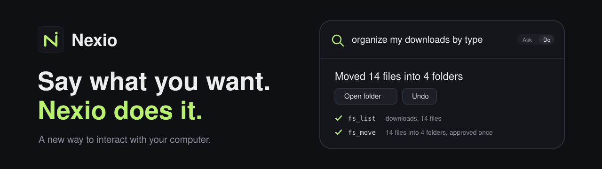

# Nexio — A new way to interact with your computer.

<p align="center">
  
</p>

<p align="center">
  <a href="LICENSE"></a>
  <a href="docs/platforms.md"></a>
  <a href="docs/platforms.md"></a>
  <a href="docs/product/implementation-status.md"></a>
</p>

Nexio is the smart layer between you and your computer. Press a hotkey, say what
you want, and AI finds, opens, organizes and does it. Say what you want. Nexio does
it on your computer.

**Yours, with your keys.** Bring your own provider keys, keep history in a local
SQLite file. Risky actions pause for your approval, every action is shown exactly
before it runs, every run is written to a log, and deletes go to the Recycle Bin
so they can be undone.

[Why Nexio](#why-nexio) · [Docs](docs/README.md) · [Quick start](#quick-start) · [How it fits together](#how-it-fits-together) · [Security](#security) · [Status](#status) · [Contributing](#contributing)

## Why Nexio

Most AI tools live in a browser tab. Nexio lives on a hotkey.

Press `Alt+Space`, say what you want done, dismiss. Nexio finds files, opens apps,
and organizes things for you. When you have not picked a mode, Nexio routes
automatically (heuristic first, one cheap model call when uncertain) and shows
`Doing` / `Answering` in the footer. An explicit mode pick always wins.
Ask can read your files to answer questions (read-only, never changes anything);
Do can change them (with approval cards before risky actions).

## Install

No releases exist. Run from source.

Prerequisites: Node >= 22.5, Windows 10/11 x64 or macOS 13+ (Apple Silicon or Intel).

```powershell
git clone https://github.com/<owner>/nexio.git  # placeholder URL; the repo has not been renamed
cd nexio
npm ci
npm run dev
```

## Quick start

1. Press `Alt+Space`.
2. Open settings, pick a provider, paste your key.
3. Try: `/summarize paste text here`.

If the hotkey is taken, change `hotkey` in settings. If the window disappears on focus loss, that is by design — reopen it from the tray. See [docs/development/troubleshooting.md](docs/development/troubleshooting.md).

## How it fits together

- The popup is a frameless window (640px, grows to fit, max 560px) on a global
  `Alt+Space` (default, configurable). It hides on blur like a launcher; the tray
  has Show / Hide + Quit; the app is single-instance. `Tab` (or `Alt+M`) switches
  Ask / Do in the composer; Nexio opens in Do mode by default.
- Ask mode answers with your own keys: `openai` (default `gpt-4o-mini`),
  `anthropic`, `gemini`, `compatible` (`http://localhost:11434/v1`, e.g. Ollama).
  Answers stream with cancel; provider usage may incur charges. Paste
  (`Ctrl+V`/`Cmd+V`), drag-drop ("Drop to attach"), or the paperclip button stages
  images/files under the composer; `Enter` on attachments alone sends "Describe the
  attached file(s)." Types are sniffed by magic bytes (max 5, 20MB/file, 50MB
  total); images are EXIF-stripped and capped at 2048px, text is BOM-decoded and
  truncated at 200KB. Temp files live under `<data>/attachments/<conversation>`
  and are deleted on conversation delete/Clear or swept after 7 days; files
  outside the working folder need per-file Allow once; non-vision models get a
  notice with a confirming "Switch model" button; logs keep name/type/size/SHA256
  only. Details: [docs/providers.md](docs/providers.md),
  [docs/configuration.md](docs/configuration.md), [SECURITY.md](SECURITY.md).
- Do mode runs a built-in tool-calling loop in the main process on top of your
  configured chat provider — no external agent CLI, no runtime picker. The model
  plans, calls file/clipboard/app/shell tools, you approve risky actions,
  everything is logged and stoppable (`Ctrl+Alt+Esc`). Reads auto-run inside
  allowed folders, writes need approval, shell commands need approval every time.
  Old `agentRuntime` / `agentBackend` / `engine` settings fall back to built-in
  and are purged on read. Details:
  [docs/architecture/local-agent.md](docs/architecture/local-agent.md).
- Slash commands and prompt templates: `/help` `/new` `/clear` `/model`
  (Ask-only) `/history` `/settings` `/log` `/extensions`; `/translate` `/rewrite`
  `/summarize` `/explain` `/analyze` `/reply`; workflows `/email-reply`
  `/requirement-review`. Palette: type `/`, ranked exact > prefix > substring >
  fuzzy, arrows + `Enter` + `Esc` + click; unknown commands show top-3
  suggestions; scopes (`Ask` / `Do` / `all`) follow the active mode. Details:
  [docs/agents/README.md](docs/agents/README.md),
  [docs/agents/workflows.md](docs/agents/workflows.md).
- Small multi-step workflows: `prompt` / `transform` / `conditional` /
  `user-input` / `output` steps; `append` / `prepend` / `replace` / `uppercase` /
  `lowercase` transforms; max 20 steps, conditional depth <= 2, last step must be
  `output`; per-step history; cancel via cancel action (Esc closes popup, may
  strand run).
- Local history in `%APPDATA%\Nexio\nexio.db` (WAL mode, override with
  `NEXIO_DATA_DIR`): Run Log tab (prompt, one-line outcome, timestamp, status,
  Undo where supported) and Ask tab (chat transcripts; nothing discarded). Note:
  message text is sent to the configured provider on each request. Reversible
  operations (`fs_move`, `fs_copy`, new-file `fs_write`, `clipboard_write`) are
  journaled per run and reversed in reverse order with precondition checks, never
  overwriting changed files, through the normal approval flow, never twice;
  `fs_trash` notes manual Recycle Bin restore; `shell_run` and MCP tools are never
  undoable. New installs get a skippable 3-step onboarding (provider + key,
  allowed folders, example prompts); existing installations skip it.
- Extensions: Agent-Skills-compatible skills, MCP servers (official SDK, stdio +
  Streamable HTTP/SSE), event hooks, and reusable workflows from `/extensions`.
  Everything installs OFF until reviewed; skills load progressively, MCP tools
  join the same registry as `mcp__server__tool`, hooks can only make permissions
  stricter. Ships with 2 example skills + 2 example workflows (disabled).
  Details: [docs/architecture/extensions.md](docs/architecture/extensions.md).

In practice: quick answers without leaving the current window; repeated rewrites
with one slash command; two-path tasks via `/email-reply` or
`/requirement-review`; local-first draft history with your own keys and models.

## Security

Reads auto-run inside allowed folders; writes and every shell command need your
approval — approval cannot be skipped or timed out. Keys live in `safeStorage` /
DPAPI in the SQLite `secrets` table (XOR fallback warns, dev only);
`redact()` masks `sk-` / `Bearer` / `api_key` before logging; dev-only env
fallback (`OPENAI_API_KEY`, etc.). Treat attached and tool text as untrusted
data. Long-term memory is off by default, encrypted when `safeStorage` is
available, and untrusted content can never write it. Read [SECURITY.md](SECURITY.md) before connecting providers or enabling
extensions.

## Documentation

| Goal                          | Start here                                                                               |
| ----------------------------- | ---------------------------------------------------------------------------------------- |
| Install and set up dev        | [Setup](docs/development/setup.md) · [Testing](docs/development/testing.md)              |
| Configure providers and keys  | [Providers](docs/providers.md) · [Configuration](docs/configuration.md)                 |
| Slash commands and workflows  | [Agents](docs/agents/README.md) · [Workflows](docs/agents/workflows.md)                  |
| Do loop, tools, approvals     | [Local agent](docs/architecture/local-agent.md)                                          |
| Skills, MCP, hooks            | [Extensions](docs/architecture/extensions.md)                                            |
| Popup, hotkey, platforms      | [Shortcuts](docs/shortcuts.md) · [Design](docs/design.md) · [Platforms](docs/platforms.md) |
| Troubleshoot or check status  | [Troubleshooting](docs/development/troubleshooting.md) · [Status](docs/product/implementation-status.md) |
| Architecture overview         | [Overview](docs/architecture/overview.md)                                                |

## Status

v0.1.0 pre-release / experimental.

**Working:** popup / hotkey / tray, Ask + streaming + cancel, slash + templates, workflows, history, `Tab` switching, router, built-in Do loop, long-term memory.

**Releases:** Windows portable verified (`release/Nexio-portable.exe`, nsis target configured); macOS dmg+zip (universal) build on a mac runner or via the release workflow. Unsigned builds work; signing/notarization needs owner credentials (see `docs/release.md`).

**Known issues:**

**Screenshots wanted:** brand assets ship in `assets/` (icon, banner, social preview); no app screenshots exist yet. Contributions welcome for: popup, slash palette, workflow run. GitHub social preview is a manual upload (no automation): Repository Settings > General > Social preview > Upload `assets/social-preview.png` (1280x640, <1MB).

Details: [docs/product/implementation-status.md](docs/product/implementation-status.md).

## Contributing

See [CONTRIBUTING.md](CONTRIBUTING.md) and [SECURITY.md](SECURITY.md). Start with [docs/](docs/README.md) and [AGENTS.md](AGENTS.md).

## License

MIT. See [LICENSE](LICENSE).
